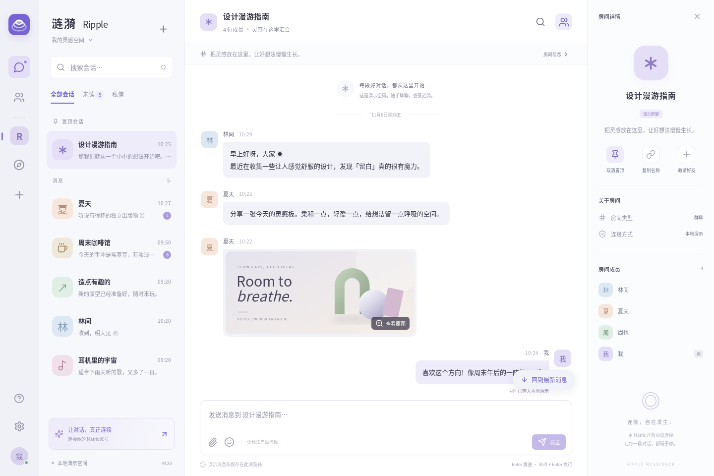

# 涟漪 Ripple

[项目仓库](https://github.com/LoganLazy/ripple-chat) · [问题反馈](https://github.com/LoganLazy/ripple-chat/issues)

> 涟漪 Ripple：基于 Matrix、React、TypeScript 与 Electron 的聊天客户端原型，支持附件、主题及响应式界面。

一个基于 **Matrix + React + TypeScript + Electron** 的聊天客户端 v0.3.0。界面和交互独立开发，协议与加密能力使用官方 Matrix SDK。雾紫色、柔和卡片和留白，支持浅色 / 深色主题。默认打开本地演示空间，连接账号后切换为真实 Matrix 会话。



## 快速运行

需要 Node.js **22.12 或更高版本**、npm，以及已有的 Matrix 服务器账号。只体验演示空间不需要账号，也不需要搭建后端。

```bash
npm ci
npm run dev
```

浏览器打开 `http://localhost:5188`。开发服务器默认仅监听本机。

桌面应用：

```bash
npm run desktop
```

Windows 可双击 `启动桌面.cmd`；Linux / macOS 可运行 `./start.sh desktop`。首次运行 Electron 会下载当前操作系统的运行时，需要网络。Linux 需桌面环境及 Electron 所需系统库。

生产构建与浏览器预览：

```bash
npm run build
npm run preview
```

也可以运行 `./start.sh`。预览监听 `0.0.0.0:5188`，适合局域网演示。**真实账号请使用 localhost、Electron 或 HTTPS**：远程 HTTP 不提供加密引擎所需的安全浏览器上下文。

## 已实现

- **v0.3 新增**：Matrix 实时输入状态；阅读历史时显示新消息数量和「回到最新」入口；点击回复引用定位已加载原消息，并短暂高亮。搜索结果中的引用也可定位，未加载原文会给出提示。
- 输入状态在连续输入时限频更新，闲置 5 秒、清空、失焦、发送或切换会话时停止；演示空间不伪造其他成员正在输入。输入状态会发送给房间成员。
- **v0.2.1**：失败消息重试 / 取消、历史加载保持阅读位置和结束提示；修复账号状态残留、会话意外切换、已读误报、本地缓存白屏、附件缓存和局域网 HTTP 兼容性，详见 [更新记录](CHANGELOG.md)。
- 演示空间：房间切换、消息发送、引用回复、表情、按房间保留草稿、消息本地保存。
- **v0.2 新增**：图片 / 文件附件（单个最大 25 MB），选择、拖放、剪贴板粘贴，上传进度与取消，图片大图预览、附件下载。
- 加密房间的附件先在本机按 Matrix v2 格式加密，下载时先验证 SHA-256 再解密；现代服务器使用带登录鉴权的媒体下载接口。
- 自己发送的文字消息支持编辑，文字与附件消息支持确认后撤回；已编辑标记、撤回占位、回复引用同步更新。
- 演示附件使用 IndexedDB 保存，刷新后仍可下载；撤回时清理对应本地附件。
- 会话搜索、当前已加载消息搜索、未读 / 私信过滤、置顶。
- 浅色 / 深色主题、窄屏布局、房间详情和成员列表。
- Matrix 密码 / 访问令牌登录，自定义服务器地址。
- Matrix SDK 真实同步、文字消息发送、发送失败重试、历史消息加载、已读回执。
- 创建私有加密房间、通过房间 ID / 别名加入、接受邀请、邀请 Matrix 用户。
- 初始化官方 Rust / WASM 加密引擎；创建的房间开启端到端加密。
- Electron 自定义安全协议、关闭 Node integration、启用 context isolation 和 renderer sandbox。

## 连接 Matrix

点击左下方「连接你的 Matrix 账号」，输入服务器完整地址、账号和密码。服务器必须提供 Matrix Client-Server API；浏览器使用时须允许该网页来源的 CORS 请求。

例如服务器 `https://matrix.example.com`，账号 `@you:example.com`。这里填写实际 homeserver 的 API 地址，不自动解析 `.well-known`。

如果服务器只允许 SSO，可在支持的客户端获取已有设备的访问令牌后使用令牌模式。本应用尚未提供 SSO 流程。**同一设备令牌不要同时用于不同客户端**；本应用通过 Web Locks 阻止同源窗口同时访问同一设备的加密数据库。

## 当前边界

这是可以继续开发的 v0.3.0 项目，目前尚未覆盖 Element 的全部功能。

- 暂不提供注册、SSO、音视频通话、推送通知。
- 暂不提供跨设备验证、交叉签名设置、恢复密钥和密钥备份恢复界面。新设备可能无法解密历史消息；有严格设备验证策略的加密房间可能需要先在完整客户端完成验证。
- 搜索仅包含已加载消息，不是全服务器历史搜索。成员列表最多预览 8 人。
- 单个附件上限 25 MB，服务器可能设置更小的限制；仅 PNG、JPEG、GIF、WebP、AVIF 做图片预览，其他类型按文件下载。真实服务器图片需点击「加载图片」。暂不支持将媒体请求重定向到外部 CDN 的服务器。
- 撤回遵循服务器权限；不保证抹除他人已保存的副本，也不会删除服务器媒体库中的已上传文件。上传完成后发送失败或取消，服务器可能保留未引用的媒体文件。
- UI 的「已发送」表示服务器已接收；不冒充对方已读。演示模式没有真实在线成员，也不发送任何网络消息。
- 访问令牌与密码只保留在当前进程 / 页面内存中；刷新或关闭需要重新登录。加密密钥由 SDK 持久化到 IndexedDB，退出后保留；演示消息与主题、置顶保存在 localStorage，演示附件保存在 IndexedDB。密码登录可能创建新设备，可在完整客户端管理旧设备。
- Windows / macOS 安装包需在目标平台构建及签名；本次不包含已签名的安装包。

## 验证

2026-11-06 发布准备复验：TypeScript 与生产构建通过，32 项浏览器测试通过。Electron 桌面用例在本机启动时发生 SIGBUS，尚未完成本轮复验；下方 v0.3.0 的33项是历史测试记录。GitHub CI 单独运行浏览器范围，桌面需在具备可用运行环境的机器验证。

```bash
npm run build
npx playwright install chromium
# 测试会自动启动生产预览，或复用已有的 5188 端口服务
npm test
```

测试覆盖演示交互、草稿隔离、消息持久化、手机布局、登录失败、凭据不写入 localStorage、真实 SDK 对模拟 Matrix 接口的登录 / 同步 / 发送 / 退出，以及 Electron 窗口和渲染隔离。另覆盖附件持久化与下载、编辑 / 撤回、上传失败与取消、密文上传、独立加密实现互通和附件篡改检测。Linux 桌面测试需要 DISPLAY（或 Xvfb），无显示环境时跳过。

v0.3.0 共 33 项测试通过，覆盖缓存异常、账号切换、稳定会话选择、已读条件、失败消息事务 ID 与取消、历史滚动、回复兼容、远程附件更新、非安全 HTTP 上下文，以及输入状态同步 / 限频 / 停止、引用导航、新消息入口、慢请求顺序、本地保存取消和手机深色布局。详见 [验证记录](docs/验证记录.md)。

Matrix 集成测试使用模拟服务器，但运行真实 SDK 和 Rust WASM 加密引擎；**尚未用用户的真实服务器账号进行两端互通与加密消息往返测试**。

开发环境可通过 `RIPPLE_CHROME` 指定已有 Chromium。此环境的桌面自动化使用 Electron 无显示器模式和 `--no-sandbox` 测试参数；应用正常启动仍启用 sandbox，测试未验证系统级沙箱的隔离效果。

## 打包

```bash
npm run pack  # 当前平台的未安装目录
npm run dist  # 当前平台的安装包，输出到 release/
```

已配置 Linux AppImage、Windows NSIS 和 macOS DMG 目标。发布前应补齐平台图标、签名与自动更新设置。

## 项目结构

```text
src/App.tsx         界面及用户交互
src/matrix.ts       Matrix 连接、同步、加密初始化与房间操作
src/attachments.ts  附件加解密、大小检查、本地存储
src/Attachment.tsx  附件显示、下载和大图预览
src/storage.ts      本地数据校验与存储降级
src/browser-utils.ts 浏览器复制与随机 ID 兼容
src/message-utils.ts 回复正文解析与发送错误类型
src/typing.ts       输入状态节流、超时与请求排序
src/useTimelineNavigation.ts 历史阅读、新消息计数与引用定位
src/demo.ts         独立的本地演示数据
src/style.css       浅色、深色与响应式样式
src/types.ts        会话与消息类型
public/            本地图标与灵感板 SVG
electron/main.cjs   Electron 主进程
tests/             浏览器及桌面自动化测试
docs/              界面预览与验证记录
```

加密附件规范：[Matrix encrypted attachments v2](https://github.com/matrix-org/matrix-spec/blob/main/content/client-server-api/modules/end_to_end_encryption.md)。

官方参考：[Matrix JS SDK](https://github.com/matrix-org/matrix-js-sdk)、[Electron 安全指南](https://www.electronjs.org/docs/latest/tutorial/security/)。

本地打包的 Noto Emoji 字体使用 SIL Open Font License，见 `docs/NotoEmoji-OFL.txt`。

项目代码尚未指定许可证；Matrix SDK、Electron、字体及其他第三方组件遵守各自许可证。仓库提供源码，不包含已签名的安装包或真实聊天记录。
